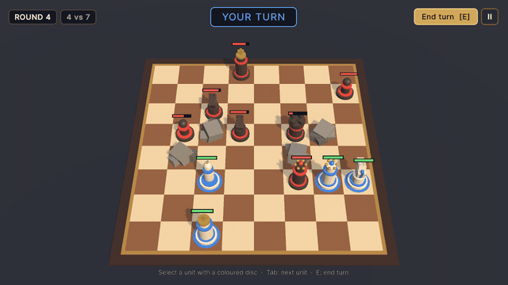
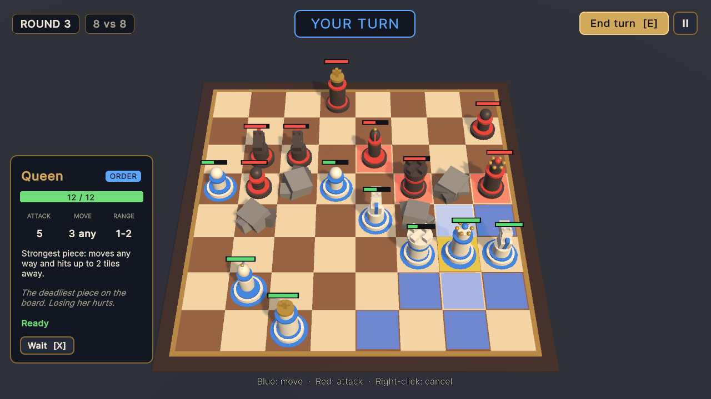
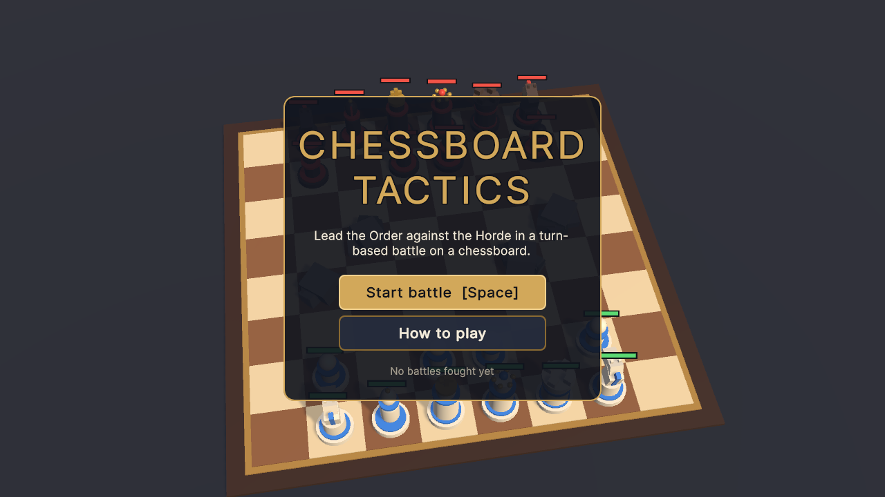
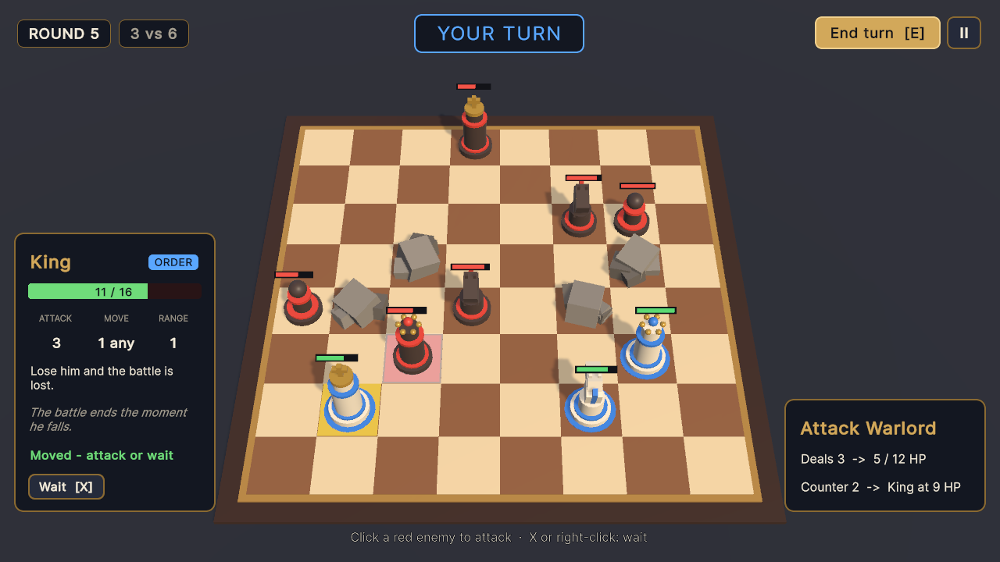
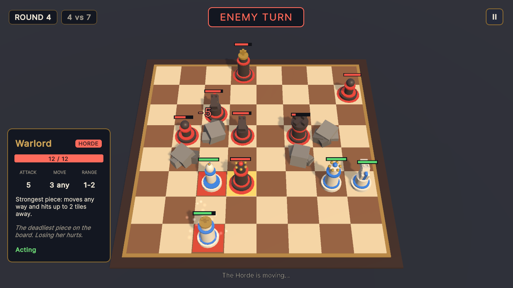
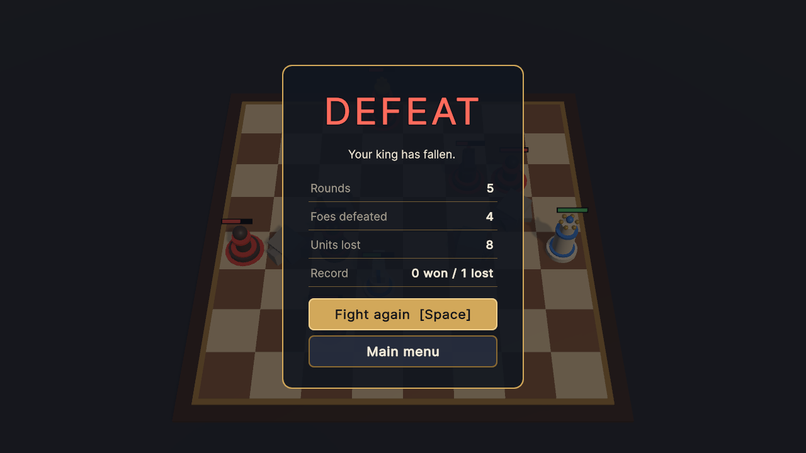

# Chessboard Tactics

A small turn-based tactics game played on a chessboard, built with Unity: lead the Order's
chess pieces against the Horde's AI army, move and strike unit by unit, and take down the
enemy King before he takes yours.





| | |
|---|---|
|  |  |
|  |  |

## Play it

- **In your browser:** [trysac.github.io/g010-chessboard-tactics](https://trysac.github.io/g010-chessboard-tactics/)
- **On itch.io:** [trysac.itch.io/chessboard-tactics](https://trysac.itch.io/chessboard-tactics)
- **Get the code:** fork this repository, or clone it:

  ```bash
  git clone https://github.com/Trysac/g010-chessboard-tactics.git
  ```

## Run it

1. Install **Unity 6000.3.27f1 (Unity 6 LTS)** with Unity Hub (add the Windows or Web build
   support module if you want to build players).
2. In Unity Hub choose **Add → Add project from disk** and select the repository folder.
3. Open `Assets/Scenes/Battle.unity` and press **Play**.

To build a player use **File → Build Profiles** (Windows or Web), or build from a terminal into
a folder outside the repository:

```bash
Unity -batchmode -quit -projectPath . -executeMethod ChessboardTactics.EditorTools.ProjectBuilder.BuildWebGL -buildOutput ../build/web
```

(`BuildWindows` works the same way.) The WebGL build is uncompressed, so it runs from any
static host such as GitHub Pages.

The tests run from **Window → General → Test Runner** (EditMode and PlayMode), or from a terminal:

```bash
Unity -batchmode -projectPath . -runTests -testPlatform EditMode -testResults results.xml
Unity -batchmode -projectPath . -runTests -testPlatform PlayMode -testResults playmode.xml
```

The README screenshots come from an opt-in hook: run a built player with
`-screenshot <folder>` (optionally `-scenario title,select,forecast,enemy,gameover`), or, without
a player, `Unity -batchmode -projectPath . -executeMethod ChessboardTactics.EditorTools.ProjectBuilder.CaptureScreenshots -screenshot <folder>`.

## Controls

| Action | Mouse | Keyboard | Gamepad |
|---|---|---|---|
| Select a unit, move, attack | Left click | Arrows / WASD to move the cursor, Space or Enter | Left stick or D-pad, A |
| Cancel the selection (or wait after moving) | Right click | Backspace or Esc | B |
| Wait (end this unit's turn) | Wait button | X | X |
| Next ready unit | — | Tab | RB |
| End the turn | End turn button | E | Y |
| Pause | Pause button | Esc | Start |
| Start / fight again | Buttons | Space | A |
| Mute | — | M | — |

## How it plays

- **Win** by defeating the enemy King or every enemy unit; lose your King and the battle is lost.
- **Turns.** On your turn each unit may move once and then attack once or wait. Units that can
  still act stand on a coloured disc; the turn ends when nobody is left or when you press End turn.
- **Combat** is deterministic: the attacker deals its full attack. A defender that survives and
  has the attacker inside its own range strikes back for half its attack (at least 1). The
  forecast panel shows the exact result before you commit.
- **Units** (two armies of ten on an 8x8 board with four rocks):

  | Unit | Health | Attack | Moves | Attack range |
  |---|---|---|---|---|
  | Pawn | 8 | 3 | walks 2 steps (no diagonals) | 1 |
  | Knight | 10 | 4 | leaps in an L over anything | 1 |
  | Bishop | 6 | 4 | slides up to 3 diagonally | 2-3 (cannot hit adjacent foes) |
  | Tower | 14 | 4 | slides up to 3 in straight lines | 1 |
  | Queen | 12 | 5 | slides up to 3 in any direction | 1-2 |
  | King | 16 | 3 | one step in any direction | 1 |
  | War Dog | 10 | 5 | walks 3 steps | 1 |

  A pawn that reaches the far rank is promoted to a War Dog and recovers 4 health. Walkers can
  pass through allies but not enemies or rocks; sliders stop before anything in the way.
- **The Horde** is played by a greedy AI that scores every reachable tile and attack (damage,
  kills, the King, counter-attacks and how much of your army could hit it next turn), keeps
  its King out of reach and never throws a unit away for a scratch.
- Victories, defeats and your fastest victory are saved on the device (PlayerPrefs).

## What I learned / technically interesting

- **Rules without the engine.** The board, movement, combat, turns, win conditions, promotion,
  the AI and the battle record live in `Assets/Scripts/Core`, a plain C# assembly with no Unity
  references, covered by 31 EditMode tests that use the same tuning the game ships. The Unity
  layer only renders, animates and reads input.
- **Fixing the original prototype with a failing test first.** The 2022 proof of concept
  checked pawn moves by comparing float distances and never looked at what stood on a tile,
  so a pawn could move onto another piece. Porting that rule to the core made the new
  `PawnCannotEndItsMoveOnAnOccupiedTile` test fail before the movement code was rewritten.
- **One movement model for every piece.** Units walk (breadth-first search with move points),
  slide (rays that stop at blockers) or jump (knight offsets). The same function drives the
  move highlights, the attack previews, the enemy threat overlay and the AI.
- **An AI you can read.** The opponent is a one-ply scorer, not a search: every candidate
  action gets a score from a few named terms and a threat map, ties are broken by unit id and
  tile, so the same position always produces the same move. A test plays two AI armies
  against each other and checks the shipped battle finishes within 60 rounds.
- **Everything is generated.** The pieces are built from primitive meshes in code
  (`PieceModel.cs`); materials, unit data, the scene, the app icon and the player settings come
  from an editor script (`ProjectBuilder.cs`); the music and sound effects come from a tiny
  Python synthesizer (`tools/audio`). The UI is UI Toolkit (UXML + USS) and input goes through
  the Input System, so mouse, keyboard and gamepad all work.
- **Rescuing old work.** This started in 2022 as a Unity 2020 proof of concept with a board,
  a pawn that could step forward and three music mixes of unknown origin. It was upgraded to
  Unity 6, the music was replaced with original audio, and the idea was grown into a complete
  battle with its own rules, AI and UI.

## Credits

Everything in the game was made for this project: pieces built in code, generated materials
and icon, synthesized audio, and Unity's default font. See [CREDITS.md](CREDITS.md).

## License

[MIT](LICENSE)
